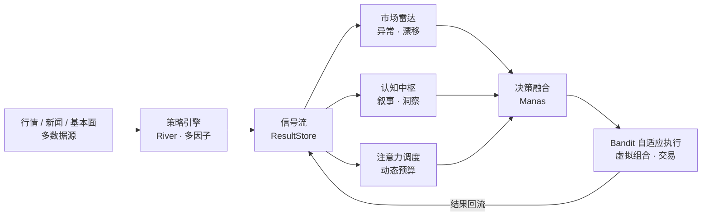

<div align="center">

# Deva · Naja

**一个会感知、会思考、会复盘的量化交易工作台。**

从行情与资讯的采集，到叙事理解、注意力调度、决策融合与自适应执行 —— 把整条投研链路收进一个可持续运行的系统。

Deva 由两层组成：底层是**异步实时流计算平台**（`deva/core/`），上层是构建其上的量化应用 **Naja**。流计算底座远早于 Naja 存在，至今仍是整个系统的数据与事件中枢。


[流计算底座](#deva-core-流计算底座) · [Naja 能力](#naja-量化交易工作台) · [快速开始](#快速开始) · [界面导览](#界面导览) · [文档中心](docs/README.md)

</div>

---

## 为什么是 Deva

大多数量化框架解决的是「写一个策略」。Deva 想解决的是「让一整套投研系统长期自己跑下去」。

它不只是把策略跑起来，而是把**数据、信号、认知、决策、执行、复盘**串成一条闭环：市场里发生的事情会变成信号，信号会被雷达和认知系统反复检视，注意力资源会向当前最值得关注的方向倾斜，决策经过融合后才落到交易，而交易结果又回流成为下一轮判断的经验。

```
数据 → 信号 → 认知 → 决策 → 执行 → 复盘 ─┐
  ↑                                      │
  └──────────────────────────────────────┘
```

## Deva Core 流计算底座

Naja 不是从零长出来的。它脚下的 `deva/core/` 是一套更早、也更通用的异步流计算引擎 —— Naja 的数据源、信号流、定时任务与事件通知，都直接建立在这些原语之上。

| 能力 | 说明 |
|------|------|
| 🌊 **Stream 内核** | `>>` 推送数据，`.map / .filter / .sink` 串联处理链，算子可通过 `register_api` 自由扩展 |
| 🔗 **管道 DSL** | sh 风格中缀语法（`|`、`>>`、`@`），内置 `head`、`average`、`groupby`、`to_dataframe`、`pmap` 等算子 |
| 🪟 **窗口与流控** | `rate_limit`、`buffer`、`sliding_window`、`timed_window`、`zip`、`combine_latest`、`delay` |
| ⏰ **调度与事件** | `timer()` / `scheduler()` / `when()` 支持间隔、cron、日期与事件触发；全局 `bus / log / warn / debug` 跨进程通信 |
| 🔌 **数据源与网络** | TCP 流与主题、异步 HTTP 采集、日志流与文件监控、SSE 推送 |
| 💾 **时序存储与回放** | `DBStream` 基于 SQLite，支持容量控制与 `replay(start, end, interval)` 历史回放 |
| 🗂️ **命名空间** | `NS / NT / NB / NW / NWT` 按名称取全局唯一对象，跨组件共享流、主题与数据表 |
| 🕸️ **流图可视化** | `create_graph` 输出流处理拓扑，可直接交给 Graphviz 渲染 |
| ⚙️ **运行时** | Tornado IOLoop 驱动，`sync()` 支持跨线程协程调用 |

几行代码就能感受到这套模型：

```python
from deva import Stream, head, pfilter

# 声明式流：数据沿链路自动向下游流动
ticks = Stream()
ticks.map(lambda x: x * 2).filter(lambda x: x > 10).sink(print)
for value in [1, 6, 10]:
    value >> ticks                        # 输出 12、20

# 中缀管道：像写 shell 管道一样组合函数
[1, 2, 3, 4] | head(2)                     # [1, 2]
range(10) >> pfilter(lambda x: x > 5)      # [6, 7, 8, 9]
```

定时任务同样可以往流里推数据：

```python
from deva import Stream, scheduler

ticks = Stream()
ticks.sink(print)
s = scheduler()
s.add_job(lambda: 42 >> ticks, seconds=5)  # 每 5 秒推送一次
```

更多可运行示例（定时器、消息总线、存储与回放、异步采集、流式检索、日志监控、矩阵计算等）见 [示例集合](deva/examples/README.md)。

## Naja 量化交易工作台

Naja 是跑在 Deva Core 之上的量化应用：把流计算能力组织成一条从市场认知到交易执行的完整链路。

| 能力 | 它能为你做什么 |
|------|----------------|
| 📡 **统一数据接入** | 行情、新闻、基本面等多源数据统一接入与管理，支持启停、调度与状态恢复 |
| 🧭 **认知中枢** | 追踪市场叙事、做跨信号分析、沉淀洞察，让系统具备跨场景的长期上下文 |
| 🎯 **注意力调度** | 按市场状态动态分配关注资源，把算力与策略优先级给到当下最相关的方向 |
| 📻 **市场雷达** | 扫描全球市场，检测异常、模式切换与概念漂移，提前发现结构变化 |
| ⚖️ **决策融合** | 多来源判断经 Manas 决策引擎融合后再输出，避免单一信号独断 |
| 🤖 **自适应执行** | 基于多臂老虎机的 Bandit 交易与虚拟组合，在实盘前完成验证与迭代 |
| 🧪 **回放实验室** | 历史数据回放与加速模拟，交易时段之外也能安全验证策略 |
| 🖥️ **一体化控制台** | Web UI 集中管理数据源、任务、策略、信号、认知与性能指标 |

## 快速开始

### 1. 安装

需要 Python 3.10 或更高版本。

```bash
pip install deva
```

也可以从源码安装：

```bash
git clone https://github.com/sostc/deva.git
cd deva
pip install -r requirements.txt
pip install -e .
```

### 2. 启动

```bash
python -m deva.naja
# 或使用安装后提供的命令
naja
```

启动后打开 **http://localhost:8080** 即可进入控制台。首次启动会自动启用实时行情、新闻雷达与注意力系统。

### 3. 选择运行模式

| 场景 | 命令 | 说明 |
|------|------|------|
| 日常实盘 | `python -m deva.naja` | 实时行情 + 新闻雷达 + 注意力系统 |
| 历史回放 | `python -m deva.naja --lab --lab-table quant_snapshot_5min_window` | 从数据库回放历史快照（仅非交易时段） |
| 认知调试 | `python -m deva.naja --cognition-debug` | 实验室 + 模拟新闻 + 调试日志 |
| 指定端口 | `python -m deva.naja --port 8081` | 自定义 Web 服务端口 |

完整参数见 [启动模式指南](docs/naja/startup_guide.md)。

## 系统如何运转



数据从多源进入策略引擎，产出统一信号；雷达、认知与注意力三条支路并行审视这些信号，再由决策层融合并交由执行层落地，最终将结果回写为下一轮的输入。图中每一条箭头，本质上都是 `deva/core/` 的一条 Stream；Naja 在其上叠加了量化语义，并以「可恢复单元」组织各组件，支持断电恢复与自动重启。

## 界面导览

启动后，控制台按能力域划分页面：

| 页面 | 路径 | 用途 |
|------|------|------|
| 总览 | `/` | 系统整体状态与关键指标 |
| 数据源 | `/dsadmin` | 配置数据接入与启停 |
| 任务 | `/taskadmin` | 定时任务调度 |
| 策略 | `/strategyadmin` | 策略注册与运行管理 |
| 信号流 | `/signaladmin` | 策略结果可视化 |
| 认知系统 | `/cognition` | 叙事追踪与洞察 |
| 注意力 | `/attentionadmin` | 注意力分配与预算 |
| 雷达事件 | `/radaradmin` | 异常与漂移事件 |
| Bandit 交易 | `/banditadmin` | 自适应交易与虚拟组合 |
| LLM 调节 | `/llmadmin` | 模型控制与参数优化 |
| 性能监控 | `/performance` | 运行时性能指标 |
| 日志流 | `/logstream` | 实时日志排查 |

## 文档

| 想了解什么 | 去哪里看 |
|-----------|----------|
| 文档总览与导航 | [docs/README.md](docs/README.md) |
| 流计算示例集合 | [deva/examples/README.md](deva/examples/README.md) |
| 启动模式与全部参数 | [启动模式指南](docs/naja/startup_guide.md) |
| 架构分层与核心思想 | [Naja 架构基线](docs/naja/naja_architecture_baseline.md) |
| 架构导览与数据流 | [Naja 架构导览](docs/guides/naja_architecture.md) |
| 策略与信号 | [策略指南](docs/naja/strategy_guide.md) |
| 雷达检测 | [雷达系统](docs/naja/radar_guide.md) |
| SR() 使用规范 | [SR() 使用策略](docs/naja/sr_usage_policy.md) |

## 项目结构

```
deva/
├── core/                  # 底层：异步流计算引擎（先于 Naja 存在）
│   ├── stream.py          # Stream 内核：订阅、发射、缓存
│   ├── pipe.py            # 中缀管道 DSL 与函数式算子
│   ├── operators.py       # map / filter / sink 等流算子
│   ├── compute/           # 窗口、流控与流图可视化
│   ├── sources.py         # TCP / HTTP / 日志等数据源
│   ├── when.py / bus.py   # 定时调度与全局事件总线
│   ├── store.py           # DBStream 时序存储与回放
│   └── namespace.py       # NS / NT / NB / NW / NWT 命名空间
├── naja/                  # 上层：量化交易平台（构建在 core 之上）
│   ├── application/       # 装配、模式与生命周期
│   ├── attention/         # 注意力系统与 Manas 决策内核
│   ├── cognition/         # 认知中枢：叙事、洞察、语义分析
│   ├── radar/             # 市场雷达与感知模块
│   ├── signal/            # 信号流处理
│   ├── strategy/          # 策略运行时
│   ├── bandit/            # 自适应交易与虚拟组合
│   ├── datasource/        # 数据接入
│   └── web_ui/            # Web 控制台
├── examples/              # 可运行的流计算示例集合
├── admin/                 # 通用管理后台
└── skills/                # 用户技能扩展
```

## 免责声明

本软件仅供学习与研究使用，不构成任何投资建议。量化交易存在风险，使用本系统产生的任何交易结果由使用者自行承担。请在充分理解策略逻辑与风险的前提下使用，切勿将回测或模拟结果视为收益保证。

---

<p align="center">
  <a href="https://github.com/sostc/deva">GitHub · sostc/deva</a>
</p>
