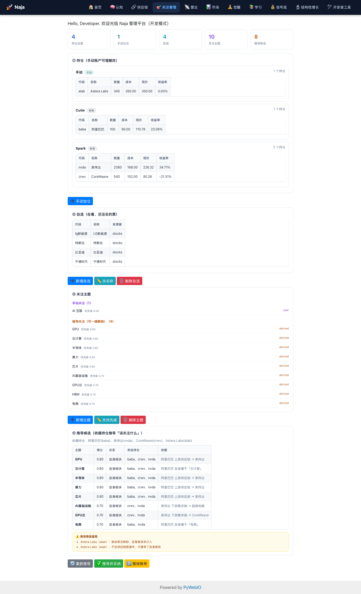

# 关注管理（Focus Admin）设计

> 目标：让**关注主题长在持仓上**——关注什么，应由"我持有什么"推导出它周边的
> 供应链与需求端，而不是随手关注一堆主题；同时给一个页面手动增删改查**主题**、
> **仓位**与**自选**。
>
> 交付：`deva/naja/news/focus_advisor.py`（推导/采纳/撤销）+ `focus_admin.py`（后端 API）
> + `ui.py`（`/focusadmin` 页面）+ 图谱/板块/账户三处数据补齐 + `手动` 第三账户
> + 自选 CRUD（`attention/portfolio.py` 增删改查 `naja_watchlist`）
> + `scripts/verify/verify_focus_advisor.py`（10 组）+ `test_news_digest.py` 追加 22 条。

---

## 1. 动机（用户 2026-10-12 原话）

> "我应该说持仓什么就应该关注它周边供应链，或者它前面需求端的这种相关的主题，
> 而不是去随意地关注一些主题……还需要多一个就是我自己手动设置的一些仓位……

拆成三件事：

1. **主题要长在持仓上**：从持仓的**周边供应链 / 前段需求端**推导关注主题。
2. **可调**：主题与仓位都能在 UI 上手动增删改查。
3. **账户补齐**：已有「虚拟仓」与「兔兔牛牛（富途）同步仓」，**再补一个用户手填账户**。

---

## 2. 盘点：原来的主题从哪来

存量关注配置在 NB 表 `naja_focus_config`，`focus_manager` 把关注项分三类：
**narratives（叙事/主题）**、**blocks（板块）**、**stocks（个股）**。

实测当时的 narratives 是 `new_energy / 新能源 / 量子计算`，`source` 全是
`investigation`（系统自动），与持仓毫无关系——正是用户说的"随意关注"。

自选另存在 `naja_watchlist`，有两个键，**语义完全不同**：

| 键 | 内容 | 谁在用 | 是否属于"用户自选" |
|---|---|---|---|
| `stocks` | 用户自选（`{code, name, add_time}`） | `Portfolio.get_watchlist()` → 新闻筛选「自选档」 | **是**（本轮新增可管理） |
| `others` | 历史遗留桶，`get_watchlist()` 也会读 | 同上 | 是（一并纳入管理） |
| `ai_stocks` | 预设 AI 股票池（22 只，带 sector/base_price） | manas `get_focus_themes`、`market_observer` | **否**，绝不能动 |

**处理**：备份到 `~/.naja/backups/focus_config_<ts>.json` 后 `fm.clear_all()` 清空
narratives / stocks / blocks，改由推导重建。

> **遗留未清**：`naja_watchlist["stocks"]` 里还留着 4 条当年跟着"新能源"叙事一起
> 加进来的自选（`宁德时代 / 比亚迪 / 特斯拉 / lg新能源`），它们与持仓
> （NVDA/CRWV/BABA）无关。按"用户数据不擅自删"的约定**没有自动清理**，
> 现在可以在 `/focusadmin` 上一键删掉（或改名 / 留作对照）。

---

## 3. 设计：持仓 → 主题推导

### 3.1 三类关系与权重

```
持仓股票 ─┬─ 自身板块   (stock_block_map)         0.60   「我持有它，它是什么」
          ├─ 上游供应链 (supply_chain_graph 直接上游) 0.50   「它靠谁活着」
          └─ 下游需求端 (直接下游)                0.50   「谁在为它买单」
                 ↓
           候选主题（score + 可读理由）
```

**聚合口径**（`focus_advisor.derive_topics`）：

```
score(主题) = max(各持仓对该主题的贡献) + 共识加分
共识加分 = min(0.10 × (命中主题的持仓数 − 1), 0.30)
```

* 用 **`max` 而不是 `sum`**：否则高频词（AI / 芯片）会因出现次数多而爆表，
  把真正有区分度的主题压下去。共识加分单独承担"多只持仓共同指向"的语义。
* 同一只持仓对同一主题只计**最大贡献**（自身 0.60 > 上下游 0.50），不重复累加。
* 每个主题都带 `evidence`（如 `英伟达 上游供应链 → 台积电`），UI 上能看到**为什么推给我**。

### 3.2 只取"直接"上下游

图谱 `supply_chain_graph.get_upstream(id, max_depth)` 的 `max_depth` 是「**额外**跳数」
（DFS 从 depth=0 起、剪枝 `depth > max_depth`），传 1 实际走**两跳**——实测 CRWV 的
上游会一路包含台积电 / 美光 / ASML。对"该关注哪些**直接**供应商 / 客户"来说二级节点是噪声。

为此给图谱新增语义明确的一跳接口：

```python
get_direct_upstream(node_id)     # 直接上游（一跳）
get_direct_downstream(node_id)   # 直接下游（一跳）
```

`focus_advisor._direct_neighbors()` 优先调它们；老图谱没有时退化为 `get_upstream(id, 0)`
（旧语义下同样是一跳）。

### 3.3 图谱与板块数据补齐

推导依赖两张表，本轮补齐了当时缺失的部分：

| 数据 | 问题 | 修复 |
|---|---|---|
| `stock_block_map` / `us_blocks.yaml` | `crwv` 被错标成 **Crown Castle** | 改为 **CoreWeave**（AI 云算力，blocks 含 AI/算力/GPU 云/AI 基础设施） |
| 同上 | `baba` 标成 `e_commerce` | 改为 `cloud_computing`（narrative 云计算） |
| `supply_chain_graph` | NVDA **只有上游、没有下游** → 需求端推不出来 | 补 6 条下游边 `nvda→msft/googl/amzn/smci/crwv/baba` 等 |
| 同上 | `skx`(SK海力士) / `lumentum`(光模块) 在图里但板块表无映射 | 补映射 |

### 3.4 过宽词不入主题

`TOO_BROAD_TOPICS = frozenset({"AI", "AI应用"})`。这类词会让几乎所有新闻都命中
"关注叙事"档，重演 2026-10-12 那个"17 个宽泛主题命中一切、分组失效"的坑，因此
**整条丢弃**（连它的 evidence 一起）。注意只丢"以它为主题"的那一条——它若挂在别的
主题的 evidence 里（`英伟达 自身属于「AI芯片」`）不受影响。

### 3.5 source 可审计 + 撤销名单

* 推导写入的主题标 `source="derived"`；用户手动加的标 `source="user"`（严格区分）。
* `apply_derived_topics` **不覆盖已存在主题**：某主题已在列表里就记 `already`，
  绝不改它的 `source`——否则"撤销推导"会把用户手动关注的一起删掉。
* `revoke_derived_topics` 只删 `source="derived"` 的项。
* **撤销名单** `naja_focus_config["revoked_derived_topics"]`：撤销过的主题记进去，
  自动采纳时跳过——否则每次启动会把用户刚删掉的又加回来。用户主动点「推导并采纳」
  则**不**受名单限制（`respect_revoked=False`）。

---

## 4. 账户体系：三类仓位并存

`PortfolioManager`（`bandit/portfolio_manager.py`）维护多账户，名册落 NB 表
`naja_bandit_portfolio_manager` 的 `account_names` 键：

| 账户 | 来源 | 持久化名册 |
|---|---|---|
| `Spark` / `Cutie` | 手工配置的券商账户 | 是（历史默认） |
| `虚拟测试` | 系统虚拟盘 | 是（历史默认） |
| `FutuReal` / `FutuSim` | 富途同步器 `register_futu_account()` 注册 | **否**（`persist=False`） |
| `手动`（本轮新增） | **用户手填** | **是**（`persist=True`） |

> 更新（2026-10-14）：上表第三行已过时。富途同步器现在按**品牌**注册
> `FutuHK` / `MoomooUS` / `MoomooSG` / …（旧名 `FutuReal` 已自动清理），
> 模拟账户另按 **`FutuSim<市场><品类>`** 注册（如 `FutuSimHK` /
> `FutuSimHKOption`）—— 模拟账户是**全局共享、不分品牌**的，所以名字里不带品牌。
> 旧的那个 `FutuSim` 空壳块（`positions={}`、无生产者）已于同日清除。

**关键改动**：

```python
MANUAL_ACCOUNT = "手动"

def ensure_account(self, account_name, *, persist=True):  # 幂等；persist 时写名册
def get_or_create_manual_account(self):                   # → ensure_account("手动", persist=True)
def register_futu_account(self, account_name):            # → ensure_account(name, persist=False)
```

* `register_futu_account` 改 `persist=False`：富途账户由同步器**每次运行**注册，
  若写进名册，同步器不跑时会在名册里留"僵尸账户"，`get_account_status` 报初始化失败。
* `手动` 账户必须 `persist=True`：**名册不落盘 → 重启后读不到**——这正是 2026-10-12
  "持仓恒为空"事故的同款形状（当时是账户建不起来，无法与"真的没持仓"区分）。

**仓位 CRUD**（`attention/portfolio.py`）：

| 方法 | 说明 |
|---|---|
| `list_manual_positions()` | 列出（纯 dict，供 UI） |
| `add_manual_position(code, name, price, quantity)` | 买入（OPEN） |
| `update_manual_position(position_id, **fields)` | 只改传入字段；`quantity<=0` 拒绝 |
| `remove_manual_position(position_id, exit_price=0.0)` | **软删除**：复用 `sell_position` 置 CLOSED，保留历史 |

`_manual_portfolio(create=False)` 供展示 / 健康检查调用——**只读检查不产生副作用**
（本项目铁律，见 `/health` 那次教训）。

---

## 4b. 自选管理：`naja_watchlist`

自选 = "在看、但还没买的票"。它与持仓**并列而不合并**：一个是"我的钱"，一个是
"我在看的"，混在一起会让前者被后者稀释（`news/digest.py` 的分组口径也是分开的）。

**CRUD**（`attention/portfolio.py`，写 `naja_watchlist` 的 `stocks`/`others`）：

| 方法 | 说明 |
|---|---|
| `list_watchlist_items()` | 读（纯 dict：code/name/add_time/bucket）；`stocks` 与 `others` 合并去重 |
| `add_watchlist_item(code, name="")` | 写入 `stocks`；已存在（大小写不敏感）拒绝；`name` 缺省用 `code` |
| `update_watchlist_item(code, name)` | 只改展示名（代码是标识，不可改） |
| `remove_watchlist_item(code)` | **物理删除**（自选没有持仓那样的历史价值，不软删） |

三条约束：

1. **绝不碰 `ai_stocks`**：写前先 `dict(nb)` 读全表、只改目标键、再整表写回——
   预设 AI 股票池是 manas 在用的资产（有测试守着）。
2. **写后必须 `invalidate_cache()`**：`_load_watchlist` 有 5 分钟 TTL 缓存，
   不失效会出现"UI 加了、报告 5 分钟后才看到"的假故障。
3. **前端 API 纯 dict**，`focus_admin.list_watchlist/add_watchlist/update_watchlist/remove_watchlist`
   一进一出都是 dict，且读失败时 `{"ok": False, "reason": ...}`，不兜底造空列表。

> **坑（本轮实测）**：`Portfolio` 是 `__new__` 单例（`cls._instance`），`Portfolio()`
> 每次返回**同一实例**且 `__init__` 早退——所以 `_watchlist_cache` 会跨调用/跨测试残留。
> 单测里显式 `invalidate_cache()`，否则上一个用例的数据会串到下一个
> （又是"缓存静默陈旧"的老形状）。

---

## 5. 采纳与撤销流程

```
derive_topics()  ── 纯计算，不写任何东西，返回候选 + evidence + degraded
       │
       ├─ apply_derived_topics(topics, respect_revoked=False)  ← 用户点「推导并采纳」
       └─ auto_apply_derived()                                 ← 启动自动采纳（respect_revoked=True）

revoke_derived_topics()  ── 只删 derived + 记撤销名单
```

**自动采纳接线**（`application/container.py`）：`_assemble_core_components()` 在
`_wire_news_focus_provider()` 之后调 `_bootstrap_derived_topics()`：后台线程
`focus-derive-bootstrap`（daemon）`sleep(5)` 后调 `auto_apply_derived()`，结果写日志。
开关 **`NAJA_NEWS_AUTO_DERIVE=0`** 可关闭。

---

## 6. UI：`/focusadmin` 关注管理页

`deva/naja/news/ui.py::render_focus_admin(ctx)`，四块 + 按钮组：

1. **持仓**（按账户分组，含账户健康状态；手动账户单列）——`➕ 手动加仓`
2. **自选**（在看还没买的票）——`➕ 新增自选`｜`✏️ 改名称`｜`🗑️ 删除自选`
3. **关注主题**（手动 / 推导分列）——`➕ 新增主题`｜`✏️ 改优先级`｜`🗑️ 删除主题`
4. **推导候选**（score + 理由）——`🔄 重新推导`｜`✅ 推导并采纳`｜`↩️ 撤销推导`

路由：`web_ui/routes.py` 注册 `(r'/focusadmin', webio_handler(focusadmin))`，
页面壳 `web_ui/pages.py::focusadmin`。

**入口放哪（2026-10-19 定）**：**不进顶部导航**。导航当时已 13 项 / 实测约 1048px
（1280 屏只剩 ~230px 余量），而本页是「配置关注主题」的低频页，不是每天要看的结果页。
现有三处入口，都够用：

| 位置 | 形态 | 用途 |
|---|---|---|
| `/news` 标题右侧 | `⚙️ 关注设置` 链接 | **主入口**——新闻页的「持仓优先排序」就吃本页数据，看到结果顺手改配置 |
| `/devtools` → 策略与交易 | 卡片 | 找不到时兜底 |
| 菜单栏托盘 → 常用页面 | 菜单项 | 不开浏览器也能进 |

**PyWebIO 铁律**：每次 `put_html` 都是**独立 DOM 片段**，未闭合标签会被浏览器补闭合
→ 本页每个 HTML 片段都**自闭合**，写完重绘整块 scope（`clear(SCOPE)` + `use_scope`）。
交互回调走 `run_async`（`ctx["run_js"]` 语义）。

后端 API（`focus_admin.py`）**纯 dict 进出**，UI 只吃 dict 副本：



| 类别 | 函数 |
|---|---|
| 主题 | `list_topics` / `add_topic` / `update_topic` / `remove_topic` |
| 仓位 | `list_positions` / `add_position` / `update_position` / `remove_position` |
| 自选 | `list_watchlist` / `add_watchlist` / `update_watchlist` / `remove_watchlist` |
| 推导 | `derive_preview` / `apply_derived` / `revoke_derived` |
| 总览 | `get_focus_overview()`（一屏：topics + positions + watchlist + derived） |

写操作后失效 `news/focus.py` 的 60s TTL 缓存（`_invalidate_focus_cache`）。

---

## 7. 验证

`scripts/verify/verify_focus_advisor.py --strict`（10 组）：

1. 图谱数据完整（NVDA 上下游、CRWV 非 Crown Castle、BABA 入图）
2. 推导正确（score / evidence / 降序 / 共识加分 / 排序稳定）
3. 推导边界（过宽词不入列表、只取直接上下游 + 对照 `get_upstream(id,1)` 会走两跳）
4. 采纳（标 derived、不覆盖、幂等）
5. 撤销（只删 derived、记 revoked、自动采纳跳过、清理探针）
6. 手动账户 CRUD（临时账户，含**子进程读回**验证落盘、清理两张表痕迹）
7. **自选 CRUD**（临时表 `__verify_watchlist__`：增/改/删 + **子进程读回**证落盘；
   结束后清临时表，并逐字节比对证明**真实自选表分毫未动**）
8. 反静默（空持仓 / 图谱外票 / 图谱不可用都留痕）
9. 静态守卫（容器接线 / 路由 / UI 出口 / HTML 片段自闭合）
10. 冷启动子进程导入

单测：`deva/naja/tests/test_news_digest.py` 追加 22 条（推导覆盖自身/上下游、只走一跳、
过宽词过滤、共识加分用 max、排序、空持仓诚实、降级留痕、to_dict 展示字段、
采纳不覆盖、阈值边界、respect_revoked、撤销只删 derived、后端 API CRUD、改优先级保 source；
自选：CRUD 往返、**不碰 `ai_stocks`**、兼容历史 `others` 桶、写后 `get_watchlist()` 立即可见、
后端纯 dict CRUD、读失败如实降级、总览含自选块、UI 块转义 + 自闭合）。

---

## 8. 边界与未做

* **只覆盖图谱里有的上下游**（硬编码 AI 芯片链）。持仓不在图里 → 退化为"仅自身板块"，
  并在 `degraded` 写明是**哪只**漏了。
* 推导是**纯结构匹配**，不做语义（"宁王"仍不命中"宁德时代"）。
* `AttentionFocusManager` 是**进程内单例**：清空 / 大改配置后，服务进程内存里可能
  留旧配置 → **必须重启服务**才干净。
* 未做：把推导做成**定时任务**（目前只在启动时跑一次 + 用户手动触发）；
  图谱数据自动化更新（仍是手工维护）。
